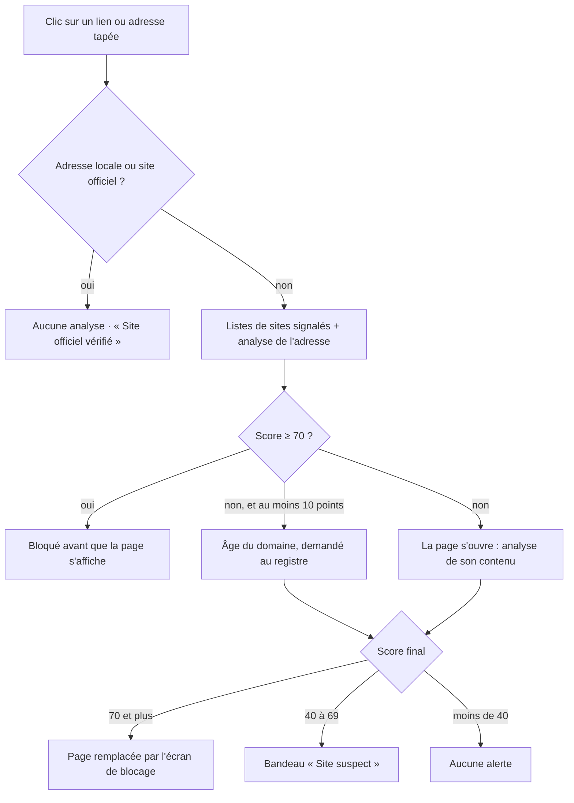

# Le système d'analyse de Virio

Ce document explique comment Virio décide qu'un site est un faux : ce qu'il regarde, combien chaque signal pèse, à quel moment il agit, et ce qu'il fait pour éviter les fausses alertes.

Tout le code de décision est dans [`src/engine/`](src/engine). Il n'utilise aucune fonction du navigateur, donc le même moteur tourne dans l'extension, dans les tests, et pourra tourner sur un serveur ou dans une app mobile.

## Les principes

1. **Seule la fin de l'adresse dit à qui appartient le site.** `impots.gouv.fr.remboursement.com` appartient à `remboursement.com`, pas aux impôts. Tout le reste de l'analyse part de cette vérité.
2. **Les signaux se combinent.** Un mot comme « paiement » dans une adresse ne prouve rien. Le nom de l'ANTAI, plus « gouv » hors de `.gouv.fr`, plus « paiement », plus un domaine créé il y a trois jours, c'est une arnaque.
3. **Chaque décision s'explique.** Chaque signal produit une phrase en français simple, affichée sur l'écran de blocage et dans la fenêtre de l'extension.
4. **Un site officiel n'est jamais bloqué.** Les vraies adresses des services surveillés sont reconnues avant toute analyse.

## Vue d'ensemble



Virio intervient à cinq moments :

| Moment | Ce qui est analysé | Ce qui peut se passer |
|:--|:--|:--|
| Avant le chargement | L'adresse et les listes de sites signalés | Blocage immédiat, la page ne s'affiche jamais |
| Après une redirection | L'adresse finale (lien raccourci, passage en https…) | Même analyse sur la nouvelle adresse |
| Quelques centaines de millisecondes plus tard | L'âge du domaine, si le site a déjà au moins 10 points | Le score monte (domaine récent) ou baisse (domaine ancien) |
| Page chargée | Le titre, les logos, les champs du formulaire, le texte | Blocage, ou bandeau « Site suspect » |
| Pendant la visite | Les nouveaux champs qui apparaissent (jusqu'à 5 nouvelles analyses pendant 2 minutes) | Blocage au moment où le formulaire de carte apparaît |

Sur un site suspect, cliquer dans un champ de carte, de code SMS ou de mot de passe fait revenir le bandeau avec le message « Attendez avant de taper ».

## Le verdict

Le score va de 0 à 100. Les points de tous les signaux s'additionnent, puis le total est ramené entre 0 et 100.

| Niveau | Condition | Ce que voit la personne |
|:--|:--|:--|
| Site officiel vérifié | L'adresse appartient à un service surveillé | Coche verte sur l'icône, et confirmation « Site officiel vérifié » après une redirection par Virio |
| Aucun signal d'arnaque | Score inférieur à 40 | Rien |
| Site suspect | Score de 40 à 69 | Bandeau en haut de la page, point d'exclamation sur l'icône |
| Arnaque probable | Score de 70 à 84 | Écran de blocage |
| Arnaque détectée | Score de 85 et plus, ou site présent sur une liste | Écran de blocage |

Quatre autres états existent : site autorisé par la personne, site ouvert malgré l'alerte (pour la durée de la session du navigateur), adresse locale, protection en pause.

Les seuils sont dans `THRESHOLDS`, dans [`src/engine/index.js`](src/engine/index.js).

## Étape 0 : à qui appartient le site ?

### Le vrai propriétaire

Virio s'appuie sur la [Public Suffix List](https://publicsuffix.org), la liste officielle des suffixes sous lesquels n'importe qui peut acheter un nom. Elle permet de trouver le **domaine enregistrable**, c'est-à-dire la partie qui a un vrai propriétaire :

| Adresse | Suffixe | Propriétaire réel |
|:--|:--|:--|
| `www.impots.gouv.fr` | `gouv.fr` | `impots.gouv.fr` |
| `impots.gouv.fr.remboursement.com` | `com` | `remboursement.com` |
| `www.amazon.co.uk` | `co.uk` | `amazon.co.uk` |
| `paypal-login.vercel.app` | `vercel.app` | `paypal-login.vercel.app`, une page créée par n'importe qui sur Vercel |

### Les sites officiels

[`src/engine/brands.js`](src/engine/brands.js) décrit 59 services souvent imités en France :

- **État et services publics** : ANTAI, impôts, Assurance Maladie, CAF, Mon Compte Formation, France Travail, ANTS, Crit'Air, Douane, FranceConnect ;
- **Péages** : VINCI Autoroutes, Sanef ;
- **Colis** : La Poste, Colissimo, Chronopost, DHL, UPS, FedEx, DPD, Mondial Relay, Relais Colis ;
- **Banques et paiement** : grandes banques françaises, banques en ligne, PayPal ;
- **Télécoms, énergie, commerce et comptes en ligne** : Orange, SFR, Free, EDF, Amazon, Apple, Google, Microsoft, Netflix, Vinted, leboncoin, Doctolib, SNCF Connect…

Pour chaque service, la fiche donne ses vrais domaines, les mots qui le désignent dans une adresse, ses noms tels qu'ils apparaissent sur ses pages, et l'adresse vers laquelle rediriger.

Une adresse appartient à un service si son propriétaire réel figure dans ses domaines, ou si elle utilise un suffixe que seul ce service peut obtenir : `.gouv.fr` pour l'État, `.bnpparibas`, `.google`, `.microsoft`. Dans ce cas, l'analyse s'arrête : le site est officiel.

### Les adresses jamais jugées

`localhost`, les noms sans point (un serveur d'entreprise), les adresses en `.local`, `.lan`, `.internal`, et les adresses IP du réseau privé (box internet, imprimante) ne sont pas analysées. Les adresses en `.localhost`, elles, le sont : elles servent aux pages de test. Seuls les signaux liés au http y sont ignorés, car le https est rarement installé en local.

## Étape 1 : les listes de sites signalés

| Source | Contenu | Format |
|:--|:--|:--|
| [Phishing Filter](https://gitlab.com/malware-filter/phishing-filter) | Agrège OpenPhish, PhishTank et IPThreat | Domaines |
| [OpenPhish](https://openphish.com) | Flux public, plus récent | Adresses complètes |

Les listes sont téléchargées à l'installation, puis toutes les 6 heures. Avant d'être gardées, elles sont nettoyées. Virio n'ajoute jamais :

- un site officiel d'un service surveillé, même si une liste le contient par erreur ;
- un raccourcisseur de liens ou un site de partage (`bit.ly`, `github.com`, `dropbox.com`…), dont le blocage casserait des millions de liens honnêtes.

La vérification se fait sur l'ordinateur, sans envoyer l'adresse visitée : Virio cherche l'adresse exacte, puis chacune de ses parties jusqu'au propriétaire réel. `abc.def.weebly.com` est trouvé si `def.weebly.com` est listé, mais un faux site sur Weebly ne fait pas bloquer tout Weebly.

**Un site présent sur une liste reçoit 100 points** : il est bloqué, avec le titre « Arnaque détectée ».

En octobre 2026, les deux listes réunies comptent environ 27 000 domaines, soit environ 770 Ko sur l'ordinateur.

## Étape 2 : l'adresse

Code : [`src/engine/address.js`](src/engine/address.js).

### Une vraie adresse cachée dans une fausse

| Signal | Exemple | Points |
|:--|:--|--:|
| Le vrai domaine d'un service, avec ses points, avant le vrai propriétaire | `impots.gouv.fr.remboursement-dossier.com` | 60 |
| Le vrai domaine d'un service écrit avec des tirets | `ameli-fr-remboursement.com` | 45 |

La recherche porte seulement sur la partie à gauche du suffixe, et ignore les domaines très courts (`me.com`, `fb.com`) pour ne pas confondre `contact-me.com` avec Apple.

### Le nom d'un service connu

| Signal | Exemple | Points |
|:--|:--|--:|
| Nom distinctif d'un service | `la-poste-suivi-colis.com`, `antai-paiement-gouv.com` | 30 |
| Mot courant qui est aussi une marque (« orange », « apple », « ups ») | `orange-bleue.fr` | 12 |
| Le même mot courant, à côté du vocabulaire de l'arnaque | `orange-facture-impayee.com` | 22 |
| Le nom exact d'un groupe international sur une autre extension | `amazon.com.au`, `paypal.de` | 5 |
| Un deuxième service cité dans la même adresse | `laposte-colissimo.com` | 5 |

Comment un nom est reconnu :

- **mot identique** : le mot `antai` dans `antai-paiement-gouv` ;
- **mot collé à des mots de remplissage** : `antaipaiement`, `ameli24`, `espaceameli` (« fr », « gouv », « espace », « suivi », des chiffres…) ;
- **nom long contenu dans l'adresse** : à partir de 7 lettres, `chronopost` est cherché partout, y compris dans `monchronopostexpress` ;
- **mots courts ou courants** (`caf`, `lcl`, `orange`) : seulement s'ils sont seuls ou collés à des mots de remplissage, jamais à l'intérieur d'un autre mot. `cafe-de-flore.fr` n'est donc pas pris pour la CAF.

### Les fautes d'orthographe volontaires

| Signal | Exemple | Points |
|:--|:--|--:|
| Nom de service déformé | `chronopst`, `arneli` (pour `ameli`), `g00gle` | 45 |

Deux techniques sont détectées :

- **les caractères qui se ressemblent**, ramenés à une forme commune avant comparaison : `rn`→`m`, `vv`→`w`, `cl`→`d`, `1`, `i`, `l`→`l`, `0`→`o`, `3`→`e`, `4`→`a`, `5`→`s`, `7`→`t`, `8`→`b` ;
- **une ou deux lettres changées, ajoutées, retirées ou inversées**. La tolérance dépend de la longueur du nom :

| Longueur du nom | Écart accepté |
|:--|:--|
| Moins de 7 lettres | Une lettre remplacée ou deux lettres inversées, même longueur. `amelie` (un prénom) n'est pas pris pour `ameli` |
| 7 à 9 lettres | Une modification |
| 10 lettres et plus | Deux modifications |

Les mots courants (« orange », « apple ») ne sont jamais testés pour les fautes.

### Le faux « gouv »

| Signal | Exemple | Points |
|:--|:--|--:|
| « gouv » ou « gouvernement » hors de `.gouv.fr` | `antai-paiement-gouv.com`, `gouv-fr-amende.com` | 45 |

Les gouvernements étrangers qui utilisent `gouv` (`quebec.gouv.qc.ca`, `gouv.nc`) et le site `gouvernement.fr` ne sont pas concernés.

### Le nom d'un service dans la suite du lien

| Signal | Exemple | Points |
|:--|:--|--:|
| Le nom d'un service dans le chemin, pas dans le domaine | `site-quelconque.com/ameli/remboursement` | 12 |

Ce signal pèse peu, parce qu'un article de presse peut avoir une adresse comme `/arnaque-ameli-comment-reagir`.

### Le vocabulaire de l'arnaque

| Signal | Exemples de mots | Points |
|:--|:--|--:|
| Mot fort, au cœur du scénario | paiement, amende, contravention, remboursement, colis, livraison, douane, facture, impayé, vérification, sécurité, suspendu, carte vitale… (51 mots) | 8 par mot |
| Mot faible, courant aussi sur les sites honnêtes | suivi, compte, espace, client, connexion, login, support, service… (44 mots) | 4 par mot |

Le total est plafonné à 22 points. Les mots qui font partie du nom du service lui-même ne comptent pas (« compte » dans `moncompteformation`).

### L'extension du domaine

| Signal | Extensions | Points |
|:--|:--|--:|
| Très utilisée par les sites jetables | `.top`, `.xyz`, `.icu`, `.cfd`, `.sbs`, `.click`, `.tk`… (25 extensions) | 15 |
| Souvent utilisée par des sites jetables | `.shop`, `.online`, `.site`, `.live`, `.info`, `.store`… (24 extensions) | 7 |

### Les plateformes de pages gratuites

| Signal | Exemples | Points |
|:--|:--|--:|
| Page hébergée sur une plateforme où n'importe qui crée un site en quelques minutes | Weebly, Firebase, Cloudflare Pages, Vercel, Wix Studio, Framer, GitHub Pages… (70 plateformes) | 10 |

Les plateformes les plus utilisées par les faux sites ont été relevées dans les listes publiques en octobre 2026 : Weebly, `web.app` et `firebaseapp.com` arrivent en tête.

### Les pièges d'écriture

| Signal | Exemple | Points |
|:--|:--|--:|
| Caractères d'autres alphabets qui imitent des lettres | `xn--mazon-wqa.com` | 25 |
| « @ » dans l'adresse : tout ce qui précède est un leurre | `https://site-officiel.fr@faux-site.com` | 40 |
| La même chose, avec le vrai domaine d'un service avant le « @ » | `https://impots.gouv.fr@faux-site.com` | 60 |
| Adresse IP publique au lieu d'un nom | `http://185.12.34.56/paiement` | 25 |
| Forme inhabituelle : 3 tirets ou plus, nom de 25 caractères ou plus, 3 sous-parties ou plus, 5 chiffres ou plus | `secure-1-verif-compte-client.com` | jusqu'à 12 |
| Connexion non chiffrée (http) | `http://…` | 5 |

### Les combinaisons

Ces points s'ajoutent quand l'adresse imite un service (vraie adresse cachée, nom, faute volontaire ou faux « gouv ») :

| Combinaison | Points |
|:--|--:|
| Nom d'un service + vocabulaire de l'arnaque | +10 |
| Nom d'un service + plateforme de pages gratuites | +20 |
| Nom d'un service + extension jetable | +5 |

## Étape 3 : l'âge du domaine

Code : [`src/services/domain-age.js`](src/services/domain-age.js).

Les faux sites vivent quelques jours ou quelques semaines. La date de création du domaine est donc un signal fort.

**Quand Virio la demande.** Seulement si le site a déjà au moins 10 points, par son adresse ou par sa page, et seulement quand la date a un sens : pas pour une page hébergée sur une plateforme gratuite (la date serait celle de la plateforme), ni pour une adresse IP.

**À qui.** Au registre officiel de l'extension, par le protocole RDAP, le successeur public de WHOIS. L'annuaire de l'[IANA](https://data.iana.org/rdap/dns.json) indique quel registre interroger : l'AFNIC pour `.fr`, Verisign pour `.com` et `.net`, etc. **Seul le nom de domaine est envoyé**, jamais l'adresse complète.

**Combien de temps la réponse est gardée** : 30 jours si la date est connue, 1 jour si le domaine n'existe pas ou si l'extension n'a pas de RDAP, 1 heure en cas d'erreur.

| Âge du domaine | Points |
|:--|--:|
| Moins de 7 jours | +40 |
| 7 à 29 jours | +30 |
| 1 à 6 mois | +18 |
| 6 à 12 mois | +6 |
| 1 à 3 ans | −8 |
| 3 ans et plus | −20 |

Un domaine ancien rassure, mais **jamais quand l'adresse imite un service**. Des escrocs rachètent des domaines anciens ou piratent de vieux sites : l'ancienneté n'excuse pas une imitation.

## Étape 4 : le contenu de la page

Code : [`src/content/content.js`](src/content/content.js) pour la lecture de la page, [`src/engine/page.js`](src/engine/page.js) pour l'analyse.

Une fois la page chargée, Virio relève :

- le titre de la page, le nom du site déclaré par la page (`og:site_name`) et les titres principaux (`h1`) ;
- le texte du haut de la page et les logos (texte alternatif et nom de fichier) ;
- les 8 000 premiers caractères du texte ;
- les champs visibles du formulaire : type, nom, texte d'aide, étiquette, saisie automatique ;
- l'adresse vers laquelle chaque formulaire envoie ses données ;
- les scripts écrits dans la page, pour y chercher un envoi vers Telegram.

Ces informations restent dans le navigateur. Elles ne sont envoyées nulle part.

### Ce que la page demande

| Information demandée | Comment elle est reconnue | Points |
|:--|:--|--:|
| Carte bancaire | Saisie automatique `cc-number`, `cc-csc`, `cc-exp`, ou des mots comme carte, CVV, cryptogramme, expiration | 20 |
| Code reçu par SMS | Saisie automatique `one-time-code`, ou « code reçu par SMS », OTP, 3D Secure | 15 |
| Informations d'identité | Numéro de sécurité sociale, date de naissance, numéro fiscal, passeport | 12 |
| IBAN | IBAN, BIC, RIB | 10 |
| Mot de passe | Champ de type mot de passe | 8 |

Le total est plafonné à 35 points. Une boutique honnête demande aussi une carte bancaire : seule, cette demande ne déclenche rien.

### La page se fait passer pour un service

Virio cherche les noms des 59 services dans les endroits où une page dit qui elle est : son titre, le nom du site déclaré et le titre principal. Le haut de la page compte seulement pour les symboles de l'État (« République française », « Liberté Égalité Fraternité »).

Les logos ne font que **confirmer**. Une boutique affiche les logos de PayPal ou de Colissimo à l'étape du paiement, ce qui ne prouve pas qu'elle les imite.

| Se présente comme un service… | Sans demande sensible | Avec une demande sensible |
|:--|--:|--:|
| …dans son titre ou son nom de site, ou à deux endroits | 12 | 40 |
| …à un seul endroit secondaire (titre principal) | 6 | 25 |

Un article de presse titré « Arnaque à l'ANTAI : comment la repérer » reçoit donc 12 points. Une page titrée « ANTAI – Paiement » qui demande une carte en reçoit 40. S'y ajoutent 15 points quand elle demande une carte ou un code SMS : se faire passer pour un service et demander de quoi payer, c'est exactement le schéma d'une arnaque.

### Les autres signaux de la page

| Signal | Exemples | Points |
|:--|:--|--:|
| Pression | « dernier délai », « sous 24 h », majoration, menace de blocage, compte à rebours, menace de poursuites, action immédiate | 10, ou 15 si deux types de pression |
| Petite somme pour débloquer un colis | « frais de réexpédition » et un montant sous 5 € | 10 |
| Envoi des données vers Telegram | `api.telegram.org/bot…` ou un jeton de robot Telegram dans la page | 40 |
| Formulaire sensible envoyé vers un autre site | Le formulaire de carte part vers `autre-domaine.com` | 8 |
| Informations sensibles demandées sans chiffrement | Carte bancaire demandée sur une page en http | 15 |

Les kits d'arnaque envoient souvent les cartes volées vers un robot Telegram. C'est rare sur un site honnête, d'où le poids de ce signal.

## Exemples chiffrés

Ces chiffres sont ceux que donne le moteur. On peut les retrouver avec `npm run check -- <adresse>`.

### Le faux site du film : `antai-paiement-gouv.com`

Bloqué avant de s'afficher, sur la seule adresse.

| Signal | Points |
|:--|--:|
| « gouv » hors de `.gouv.fr` | 45 |
| Nom de l'ANTAI dans une adresse qui n'est pas la sienne | 30 |
| Mot « paiement » | 8 |
| Combinaison nom + vocabulaire de l'arnaque | 10 |
| **Total** | **93 : arnaque détectée** |

L'écran de blocage propose `amendes.gouv.fr`.

### Un faux suivi de colis : `la-poste-suivi-colis.com`

| Signal | Points |
|:--|--:|
| Nom de La Poste | 30 |
| Mots « colis » (8) et « suivi » (4) | 12 |
| Beaucoup de tirets | 6 |
| Combinaison nom + vocabulaire de l'arnaque | 10 |
| **Sous-total, adresse seule** | **58 : suspect** |
| Domaine créé il y a 4 jours | 40 |
| **Total** | **98 : arnaque détectée** |

L'adresse seule ne suffit pas à bloquer. C'est l'âge du domaine, connu quelques centaines de millisecondes plus tard, qui fait basculer.

### Une adresse presque neutre, une page qui se trahit : `paiement-dossier-2026.fr`

La page s'intitule « ANTAI – Paiement de votre avis de contravention », réclame 35 € « sous 48 h pour éviter la majoration » et demande la carte.

| Signal | Points |
|:--|--:|
| Mots « paiement » (8) et « dossier » (4) | 12 |
| La page se présente comme l'ANTAI et demande une information sensible | 40 |
| Elle demande une carte bancaire | 20 |
| Pression : délai et majoration | 15 |
| Se faire passer pour l'ANTAI et demander de quoi payer | 15 |
| **Total** | **102, ramené à 100 : arnaque détectée** |

### Un site honnête : `www.lemonde.fr`

Aucun signal dans l'adresse, domaine créé en 2002, rien de sensible demandé : 0 point, aucune alerte.

## Ce qui évite les fausses alertes

- Les vraies adresses de 59 services sont reconnues avant toute analyse, et les `.gouv.fr` sont toujours officiels.
- Les marques qui sont aussi des mots courants (« orange », « apple ») pèsent peu et ne sont jamais testées pour les fautes.
- Les noms courts ne sont jamais cherchés à l'intérieur d'un autre mot (`cafe` n'est pas la CAF).
- Les noms de moins de 7 lettres n'acceptent qu'une lettre remplacée à longueur égale (`amelie` n'est pas `ameli`).
- Les groupes internationaux sur une autre extension (`amazon.com.au`) ne comptent presque pas.
- Les logos seuls ne prouvent rien, et une page qui cite un service sans rien demander reçoit peu de points.
- Un domaine ancien enlève des points, sauf si l'adresse imite un service.
- Les listes sont nettoyées des sites officiels et des raccourcisseurs de liens.
- Le réseau local n'est jamais jugé.

En octobre 2026, 120 sites français connus (presse, commerce, banques, assurances, sites publics, transport, énergie) ont été passés au moteur : aucun n'a déclenché d'alerte. Les 13 tests de [`tests/engine.test.js`](tests/engine.test.js) vérifient ces règles à chaque modification.

En cas de doute, la personne garde la main : sur un site suspect, elle peut indiquer qu'elle lui fait confiance. Sur l'écran de blocage, elle peut ouvrir le site après une confirmation.

## Vie privée

| Donnée | Où elle va |
|:--|:--|
| L'adresse des sites visités | Nulle part. Elle est analysée dans le navigateur. |
| Le contenu des pages | Nulle part. Il est analysé dans le navigateur. |
| Le nom de domaine d'un site déjà suspect | Au registre officiel de son extension (AFNIC, Verisign…), pour connaître sa date de création |
| Les listes de sites signalés | Téléchargées depuis leurs sources publiques, comme un simple fichier : rien n'est envoyé |

Virio n'a pas de compte utilisateur et n'envoie rien à un serveur Virio (il n'en existe pas encore). Sur l'ordinateur, il garde seulement les listes, la date de création des domaines déjà vérifiés (30 jours au plus) et les sites que la personne a autorisés.

## Limites connues

- **L'adresse seule repère peu de faux sites sans marque.** Sur les 27 000 domaines des listes, l'adresse seule (sans liste, sans âge, sans contenu) en bloque 0,2 % et en signale 0,8 %. La plupart sont des adresses au hasard sur des plateformes gratuites, sans nom de marque. Ils sont arrêtés par les listes, et les nouveaux, pas encore listés, par l'âge du domaine et le contenu de la page.
- **Un blocage déclenché par le contenu arrive après l'affichage.** La page apparaît une fraction de seconde avant d'être remplacée, toujours avant que la personne ait eu le temps de taper sa carte.
- **Pas d'âge pour certaines extensions.** `.de`, `.io`, `.co`, `.be` et `.eu` n'ont pas de RDAP public. Il faudra passer par WHOIS depuis un serveur.
- **Les vieux sites piratés.** Une fausse page ANTAI hébergée sur un vieux site piraté, avec une adresse sans marque, peut recevoir le bandeau plutôt que le blocage : son ancienneté lui retire des points.
- **59 services surveillés.** Une arnaque qui imite un service absent de la liste n'est repérée que par ses autres signaux.
- **Telegram** n'est cherché que dans les scripts écrits dans la page, pas dans les fichiers de script séparés.

## Faire évoluer le moteur

| Pour… | Modifier |
|:--|:--|
| Ajouter un service | [`src/engine/brands.js`](src/engine/brands.js) : ses vrais domaines (vérifier qui les possède : ils seront considérés comme sûrs), ses mots, ses noms, son adresse officielle |
| Ajouter des mots, extensions ou plateformes | [`src/engine/words.js`](src/engine/words.js) |
| Changer un poids | Le fichier du signal : `address.js`, `page.js`, ou `index.js` pour l'âge et les combinaisons |
| Changer les seuils | `THRESHOLDS` dans [`src/engine/index.js`](src/engine/index.js) |
| Ajouter une liste de sites signalés | `blocklists` dans [`src/config.js`](src/config.js), après avoir vérifié sa licence |

Après chaque modification :

```bash
npm test
npm run check -- antai-paiement-gouv.com www.amendes.gouv.fr
```
